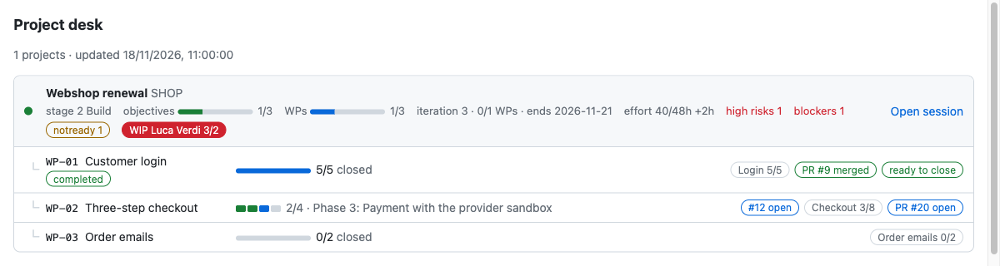
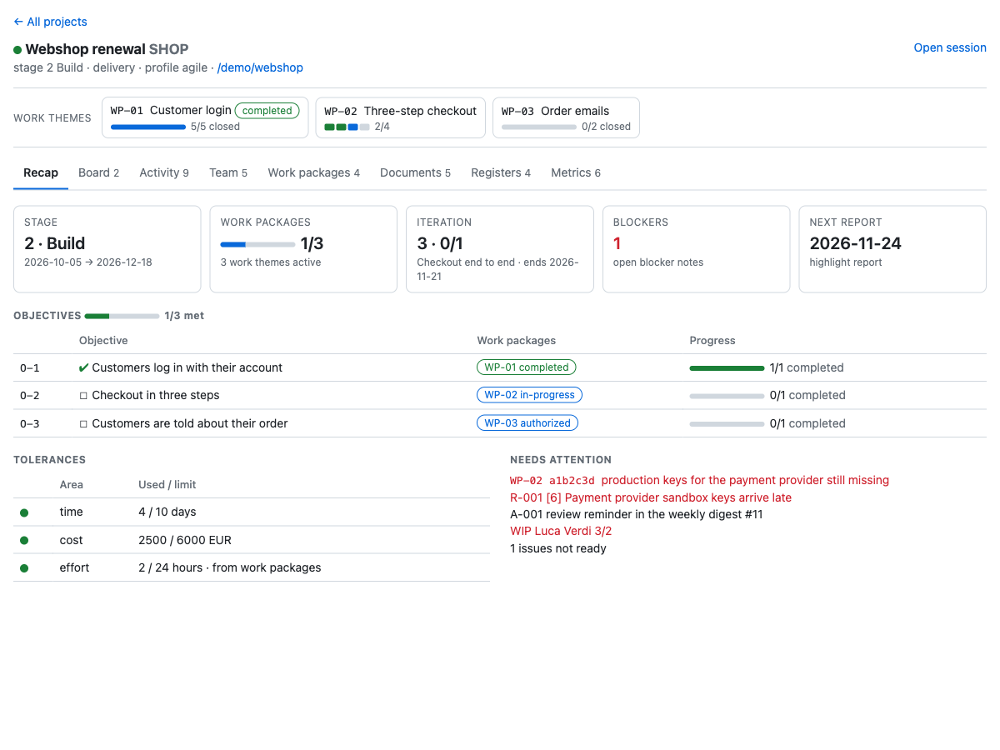
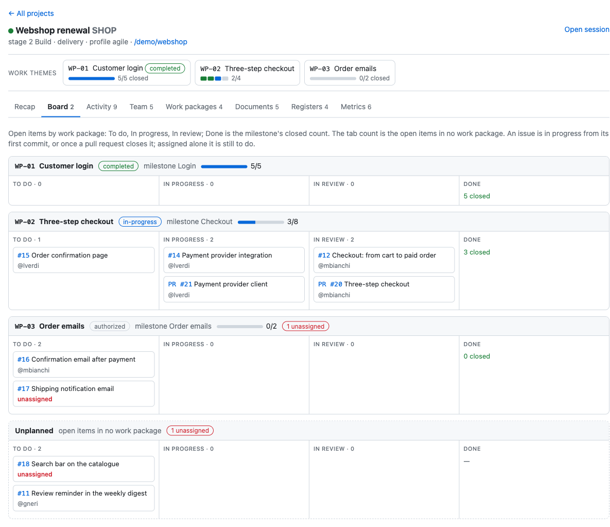
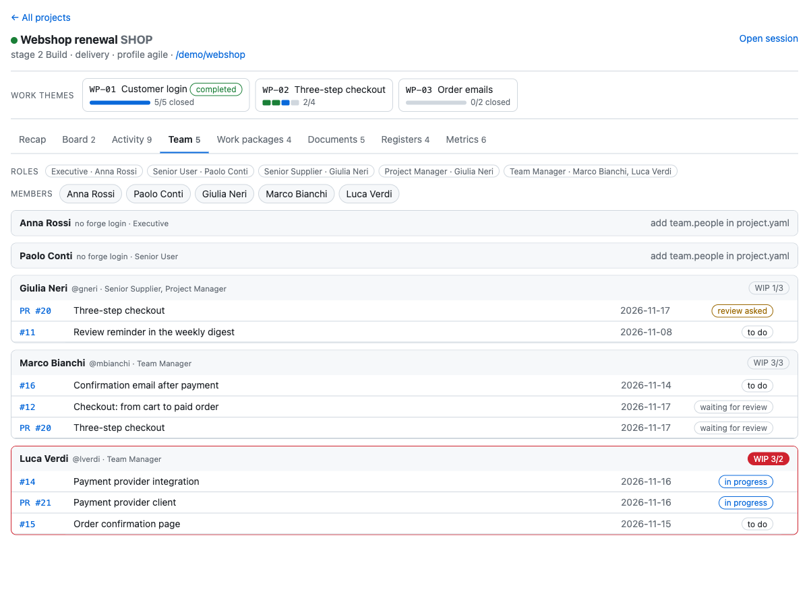
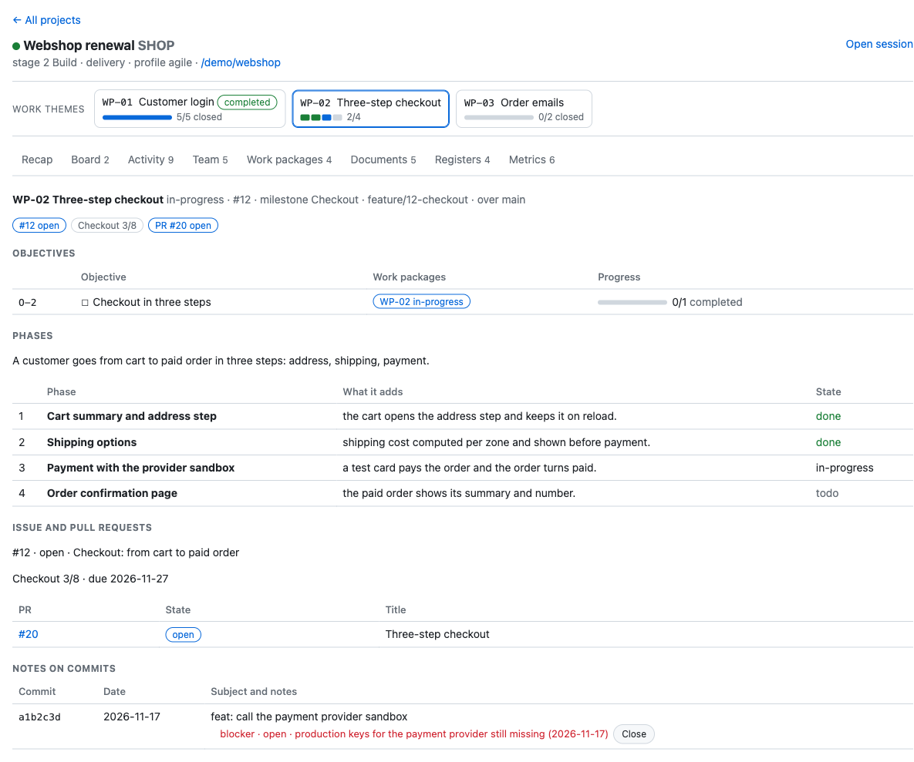
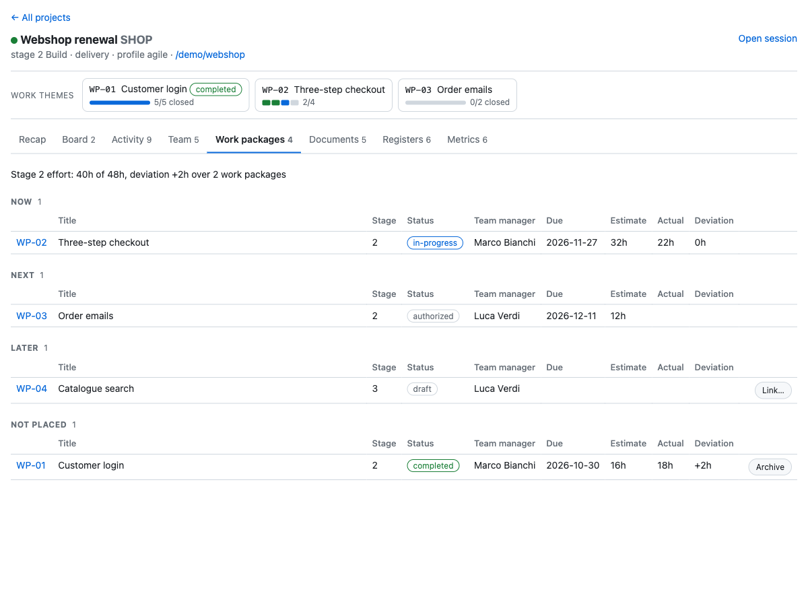
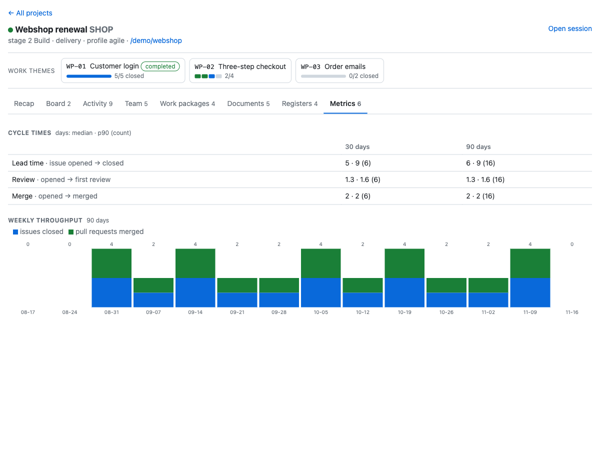

# p2kit — a guide for the project manager

p2kit helps one project manager run one or more software projects from Claude Code. Two things
do the work:

- **Skills** that draft the management documents — brief, plan, reports, digests, retrospectives —
  from what you tell Claude and from the state of the forge. Claude prepares; you, as the Project
  Board's voice, decide. Nothing is approved until you say so in chat.
- **The project desk**, a pane in Claude Desktop (and the same page in the browser) that shows every
  project at a glance: stage, objectives, work packages, who is doing what, what is stuck.

All the data lives in `.pm/` inside the project's own repository, versioned with the code. There is
no server and no database.

The screenshots below come from a demo project, *Webshop renewal*, on the fictional repo
`acme/webshop`: PM Giulia (`gneri`), developers Marco (`mbianchi`) and Luca (`lverdi`).

## What it helps with

| You need to… | p2kit gives you |
|---|---|
| turn an idea into a project | `/pm-start-up` (Project Brief with measurable objectives), `/pm-initiate` (PID and first stage plan) |
| split the work | work packages (`.pm/work-packages/WP-nn.md`), each tied to a forge milestone or issue — `/pm-package`, `/pm-issue`, `/pm-link` |
| decide what comes first | `/pm-roadmap`: Now / Next / Later, plus a version for outsiders with no internal ids |
| know where things stand | the desk, refreshed from git and the forge (GitHub or Forgejo) |
| see who is overloaded or stuck | the Team tab: each person's items, WIP limit, stalled reviews |
| report | `/pm-digest` (weekly, for the alignment meeting), `/pm-report` (Highlight Report for the Board) |
| keep a diary | `/pm-log`: forge events, meeting decisions and actions |
| handle risks | `/pm-risk`: how each risk is handled, an adequate / not adequate verdict, closure on your confirmation |
| learn | `/pm-retro`: what to keep, what to change, actions opened as issues |

## The desk

**Overview** — one row per project, its work themes (the work packages being delivered) below.
The dot is the worst tolerance light; badges flag what needs you: an issue not ready, a person over
their WIP limit, an open blocker.

**Recap** — the project's form opens here: stage, objectives and the work packages serving each,
tolerances, and *Needs attention*.

**Board** — one swimlane per work package: To do, In progress, In review, Done. *Unplanned* holds
the open items that belong to no work package. Drag an item onto a lane to put it in that work
package, or create a new issue in it with *+ issue*; assigning is on the Team and Activity tabs.
(The demo page here is read-only, so those buttons are not shown.)

**Team** — each person with their open items and whose move it is. Luca is over his WIP limit of 2;
Giulia has a review waiting for her.

**Work theme** — click a work package to see its phases, its issue and pull requests, and the
internal notes on its commits (here an open blocker).

**Work packages** grouped by roadmap horizon, with estimate, actual and deviation; **Metrics** gives
lead time, review and merge time and the weekly throughput.

The other tabs: **Activity** (milestones, open issues and pull requests, with a selection bar to
package or assign many at once), **Documents** (the `.pm/` products and the Daily Log),
**Registers** (risks, approvals, problems, lessons, iterations).

## A task from assignment to merge

p2kit is the PM's view of the project; [forge-desk](https://github.com/dgpaci/forge-desk) is each
person's view of their own issues and pull requests ([its guide](https://github.com/dgpaci/forge-desk/blob/main/docs/guide.md)). They read the same forge, so a task moves on
both at the same time. Take issue #12 of WP-02, *Three-step checkout*.

1. **Giulia assigns it.** From the desk she creates the issue in the work package's milestone and
   assigns it to Marco (or drafts it with `/pm-issue`). The issue carries the readiness headings —
   *Why*, *What changes*, *Done when* — otherwise it is flagged `notready`.
   *p2kit:* To do on WP-02's lane. *Marco's forge-desk:* `todo`.
2. **Marco starts.** He presses *Solve* on his forge-desk, which opens a Claude session in his
   checkout. His first commit referencing #12 moves it on.
   *p2kit:* In progress. *forge-desk:* `inprogress`.
3. **With the phased workflow.** If Marco works with the `wf` plugin, the branch carries a plan
   (`.phased/active/<slug>/plan.md`) split into phases. The desk reads it from the branch and the
   work package shows `2/4 · Phase 3: …` with what each phase adds — so Giulia follows progress
   phase by phase, not only at the end. The desk reads local git and never fetches: Giulia's
   checkout needs a `git fetch` to see new phases.
4. **Review.** Marco opens the pull request with `Closes #12` and asks Giulia to review.
   *p2kit:* In review; Team shows `review asked` on Giulia. *Giulia's forge-desk:* `review`, with a
   *Review* button that opens a session to read the change; nothing is posted without her OK.
   *Marco's forge-desk:* `waiting` — and `stalled` after 7 days without news.
5. **Merge.** Once approved and green, the PR is `ready` on Marco's forge-desk; *Merge* merges it
   and the forge closes #12. *p2kit:* the milestone's Done count goes up.
6. **Closing the work package.** When every pull request of the work package is merged and none is
   open, the desk marks it `ready to close`. Declaring it `completed` is a Board decision: Giulia
   does it from the desk (or tells Claude), then *Archive* takes it off the work themes.
   `/pm-present` can turn it into release notes for the users.

## What Claude does not do

- It never records a Board decision on its own: approvals, a completed work package, a met
  objective are written only after you state them.
- Every change from the desk shows a preview first and writes on *Confirm*; forge writes go through
  `gh` or `fj`, already authenticated on your machine.
- It does not commit `.pm/`: you commit it with the code, when you decide.

Installation and the list of skills: [README](https://github.com/dgpaci/p2kit#readme). The `.pm/` format:
[pm-schema.md](pm-schema.md). Scope and desk actions: [scope.md](scope.md).
